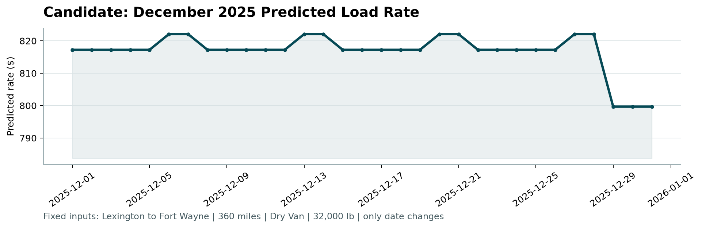

# Freight Rate ML

[](https://huggingface.co/spaces/waleedarif1011/freight-rate-ml)
[](https://github.com/waleedarif1011/freight-rate-ml/actions/workflows/ci.yml)
[](LICENSE)

Interactive **spot truckload rate** quoter backed by a LightGBM rate-per-mile (RPM) model.

> **Live demo:** after the Hugging Face Space is created (see [Deploy](#deploy-hugging-face-space)), open the badge URL above. Until then, run locally with `python app.py`.

## Problem

Given origin/destination lane, equipment, weight, calendar, distance, and market signals, predict the posted truckload rate (`posted_rate`). The model learns RPM, then converts with `predicted_rate = rpm × distance`.

## Results (Sep–Oct holdout)

| Model | MAE ($) | MAPE |
|-------|---------|------|
| Equipment median RPM | 229.10 | 10.49% |
| **LightGBM** | **112.34** | **4.97%** |

Full metrics: [`artifacts/metrics.json`](artifacts/metrics.json).

### December forecast (fixed Lexington → Fort Wayne lane)



## Quickstart

```bash
python -m pip install -r requirements.txt
python app.py                  # Gradio quoter at http://127.0.0.1:7860
python -m src.train            # retrain + refresh artifacts
```

Optional scoring / validation:

```bash
python -m src.predict
python score.py \
  --predictions validation_predictions.csv \
  --december-predictions data/december_chart_inputs.csv
```

## Method (short)

- **Split:** train Jan–Aug 2025, evaluate Sep–Oct (same temporal gap as the Nov–Dec holdout).
- **Target:** RPM; convert with distance.
- **Features:** distance, equipment, calendar, geo (haversine/bearing), market index / quote signal.
- **Missing data:** weight by equipment median; market/quote by date → day-of-year → month.
- Details: [`report.md`](report.md). Assessment brief (reference only): [`docs/Freight_Rate_ML_Assessment.pdf`](docs/Freight_Rate_ML_Assessment.pdf).

## Tests & CI

```bash
python -m pytest -q
```

GitHub Actions runs the same suite on every push/PR (`.github/workflows/ci.yml`).

## Deploy (Hugging Face Space)

This repo is Space-ready (`app.py` + Gradio README frontmatter). Create and push:

```bash
# once: huggingface-cli login   # needs a write token with Spaces scope
huggingface-cli repo create freight-rate-ml --type space --space_sdk gradio -y
git remote add space https://huggingface.co/spaces/waleedarif1011/freight-rate-ml
git push space HEAD:main
```

Or in the Hub UI: **New Space → Gradio →** upload `app.py`, `src/`, `artifacts/`, `scorer_results/`, `requirements.txt`, and this `README.md`.

## Layout

```
app.py           Gradio “Quote a Truckload Lane” demo
src/             load → features → train → predict
artifacts/       model, feature state, metrics, lane list
scorer_results/  December forecast chart
tests/           pytest smoke tests
docs/            assessment PDF + report PDF
score.py         provided validator / December chart helper
```

## License

MIT — see [`LICENSE`](LICENSE).
