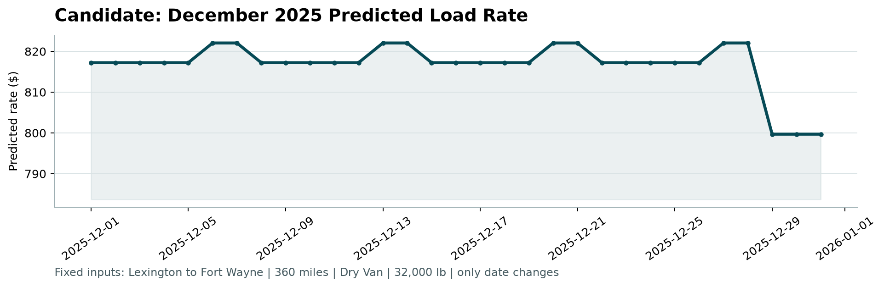

# Freight Rate Prediction — Technical Report

Predict `posted_rate` ($) for freight loads from lane, equipment, weight, date, and market signals. This write-up covers the split, data quality handling, model choice, and the December chart produced by `score.py`.

---

## 1. Problem

Labeled development data and the unlabeled Nov–Dec holdout are summarized below.

| Dataset | Rows | Date range | Label |
|---------|------|------------|-------|
| `data/train_test.csv` | 48,000 | 2025-01-01 → 2025-10-31 | `posted_rate` |
| `data/validation.csv` | 12,000 | 2025-11-01 → 2025-12-31 | none |
| `data/december_chart_inputs.csv` | 31 | 2025-12-01 → 2025-12-31 | fixed Lexington→Fort Wayne lane |

Validation is a **future period** relative to training, so evaluation and modeling treat time as first-class.

---

## 2. Exploratory findings

- **Distance dominates:** correlation with `posted_rate` ≈ **0.91**. Rates scale roughly linearly with miles.
- **Equipment shifts RPM** (rate per mile): Reefer (~2.38) > Flatbed (~2.30) > Dry Van (~2.12).
- **Market index** moves seasonally through 2025 (higher in late spring / early summer) while average rates move more mildly.
- **Coverage gap:** validation introduces 8 new cities and ~736 lanes unseen in train → models must generalize beyond pure lane lookup.
- **Lexington → Fort Wayne** appears 32 times in train; Dry Van rates roughly **$760–$970**, consistent with the December chart setup (360 mi, Dry Van, 32,000 lb).

---

## 3. Data-quality issues and fixes

| Issue | Train | Validation | Fix |
|-------|-------|------------|-----|
| Missing `weight` | 300 | 165 | Median by equipment (global median fallback) |
| Missing `market_index` | 374 | 249 | Median by date → day-of-year → month → global |
| Missing `quote_signal` (rare / Dec absent) | — | — | Same seasonal / date imputation |
| December lacks lat/lon, market, quote | — | — | City median coords + seasonal market/quote imputation |

Fit statistics are computed **only on the training portion** of each split to avoid leakage.

Extreme rates (e.g. > $10k) exist but were left in training; LightGBM is robust to heavy tails, and the RPM target reduces scale sensitivity.

---

## 4. Train / validation split

Because the official holdout is Nov–Dec 2025, a **random K-fold would be optimistic**.

**Local protocol**

- **Train:** 2025-01-01 → 2025-08-31 (38,477 rows)
- **Local validation:** 2025-09-01 → 2025-10-31 (9,523 rows)

**Final model:** retrain on all labeled data (Jan–Oct) with the early-stopping round count from the local split, then score Nov–Dec validation loads.

Primary metrics: **MAE** and **MAPE** (RMSE secondary).

---

## 5. Features and target

**Target:** `rpm = posted_rate / distance`, then at inference `predicted_rate = max(pred_rpm × distance, ε)`.

**Features**

- Core: `distance`, `log1p(distance)`, imputed `weight`, equipment code
- Calendar: month, day-of-week, week-of-year, month sin/cos
- Geo: pickup/delivery lat/lon, haversine miles, bearing
- Market: `market_index`, `quote_signal`, `distance × market_index`

---

## 6. Model choice

1. **Baseline:** equipment-median RPM × distance  
2. **Primary:** LightGBM regressor on RPM (tabular + mixed feature types, fast, strong default accuracy)

LightGBM was preferred over linear models because equipment, geo, and calendar effects interact non-linearly with distance and market conditions. Stacking was avoided to keep the solution reproducible within the time budget.

### Local Sep–Oct results

| Model | MAE ($) | RMSE ($) | MAPE (%) |
|-------|---------|----------|----------|
| Equipment-median RPM | 229.10 | 670.66 | 10.49 |
| LightGBM | **112.34** | 631.97 | **4.97** |

LightGBM roughly **halves MAE** and MAPE versus the strong distance/equipment baseline.

---

## 7. December prediction path

The December file provides only pickup, delivery, distance, equipment, weight, and date.

Pipeline:

1. Attach Lexington / Fort Wayne coordinates from train city medians.
2. Leave `market_index` / `quote_signal` missing so seasonal imputation fills December days.
3. Score with the same LightGBM RPM model.
4. Write predictions back into the original 7-column schema required by `score.py`.

Predicted December rates landed in approximately **$800–$822**, inside the historical Lexington→Fort Wayne Dry Van band.

### December chart (`score.py`)



---

## 8. How to reproduce

```bash
python -m pip install -r requirements.txt
python -m src.train
python -m src.predict
python score.py --predictions validation_predictions.csv --december-predictions data/december_chart_inputs.csv
```

Key code:

- `src/features.py` — imputation, geo/calendar features, RPM target  
- `src/train.py` — time split, baseline, LightGBM, artifact export  
- `src/predict.py` / `src/december.py` — validation + December inference  

---

## 9. Submission checklist

- [x] Reproducible GitHub-ready repository with README  
- [x] `validation_predictions.csv` (12,000 IDs)  
- [x] `scorer_results/candidate_december.png`  
- [x] This report (split rationale + December chart)  
- [ ] 2–3 minute Loom (see README outline)
